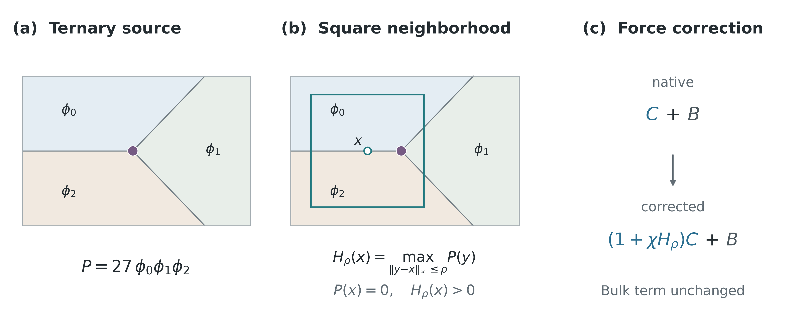

# Spatial capillary correction for driven junctions

Research software and reproducibility material for **A spatial capillary
correction for driven junction motion in double-obstacle multiphase-field
simulations**, by Ayas Alzanki.

[Manuscript](paper/manuscript.pdf) · [Supplement](paper/supplement.pdf) ·
[Simulation guide](docs/SIMULATIONS.md) · [Reproducibility](docs/REPRODUCIBILITY.md)

The correction extends a ternary-support signal into a spatial neighborhood and
multiplies the capillary contribution while retaining the bulk-driving term.
The retained comparisons include B2 driven fronts, interacting junction pairs,
a declared Grose–Asimow reconstruction, and transfer to OpenPhase without
refitting the correction strength or radius. The method is assessed in the
specific driven geometries and numerical recipes reported in the paper.



## Quick start: reproduce figures

Python 3.10 or newer is required. From the repository root:

```sh
python3 -m venv .venv
source .venv/bin/activate
python -m pip install -r requirements.txt
python scripts/verify_release.py
python scripts/build_figures.py
python scripts/build_method_schematic.py --output-dir build/figures
```

Outputs go to `build/figures/`. This rebuild reads the ten included CSV exports
and requires no private workspace, remote dataset or simulation run. The retained
Matplotlib 3.9.4 check reproduced all five result/graphical-abstract PNG files
byte-for-byte. The schematic is an illustration, not simulated data.

## Numerical reproduction

The [simulation guide](docs/SIMULATIONS.md) describes kernel compilation,
short verification runs, frozen inputs, case configurations and full-horizon
commands. A C compiler is needed for the B2 and reconstructed Grose kernels.
The OpenPhase caller additionally requires the pinned public OpenPhase source
and its dependencies; no compiled libraries are bundled.

Short release checks exercise the exported implementations. They are not a
fresh full-horizon rerun of the paper. Long benchmark calculations should be
planned for the resources available on the user's machine.

## Repository contents

| Path | Purpose |
| --- | --- |
| `src/` | Numerical kernels and OpenPhase insertion caller. |
| `scripts/` | Portable build/run entrypoints, figure generation and file verification. |
| `configs/` | Frozen case settings and observation conventions. |
| `inputs/` | Compact initial fields and input provenance. |
| `data/figure_data/` | Ten frozen CSV exports used by figures and tables. |
| `figures/` | Retained manuscript figures and graphical abstract. |
| `paper/` | Manuscript, supplement, bibliography, editable TeX and style files. |
| `tests/` | Short numerical release qualification. |
| `provenance/` | Source mapping, integrity hashes and qualification records. |

The public package omits machine-specific compute infrastructure and large
historical checkpoint archives. See [reproducibility levels](docs/REPRODUCIBILITY.md)
for what can be rebuilt directly and what requires a new simulation.

## Scope

This is a finite-recipe accuracy study. It does not establish a universal
parameter rule, a causal junction-angle mechanism or an optimized accuracy–cost
frontier. The late OpenPhase long-pair shape miss and empty-boundary outcomes
are retained. The Grose–Asimow implementation is a source-based reconstruction,
not the authors' executable. The optional local-memory rule is a separate
history-dependent variant.

## Citation and license

Use [CITATION.cff](CITATION.cff) to cite this software version, and cite the
accompanying manuscript when using its results. The initial release is
`v1.0.0`. Its Zenodo archival DOI is pending; no DOI is asserted here.

Original material is licensed under GPL-3.0-only. Elsevier LaTeX style files
retain their LPPL licenses, and separately obtained dependencies retain their
own licenses. See [LICENSE](LICENSE) and [THIRD_PARTY.md](THIRD_PARTY.md).
